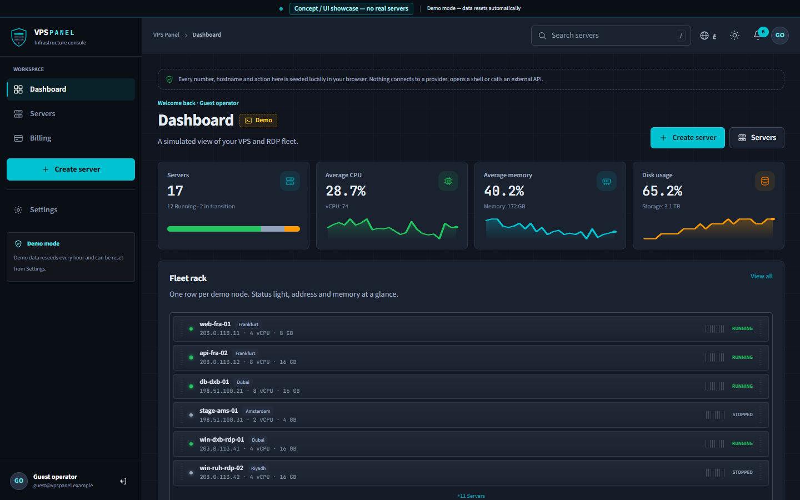
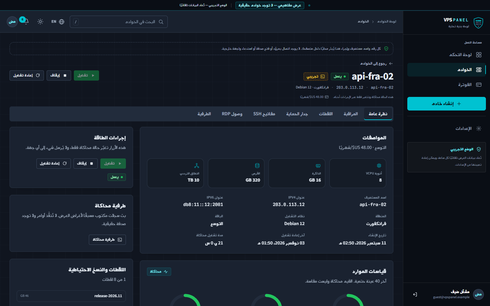
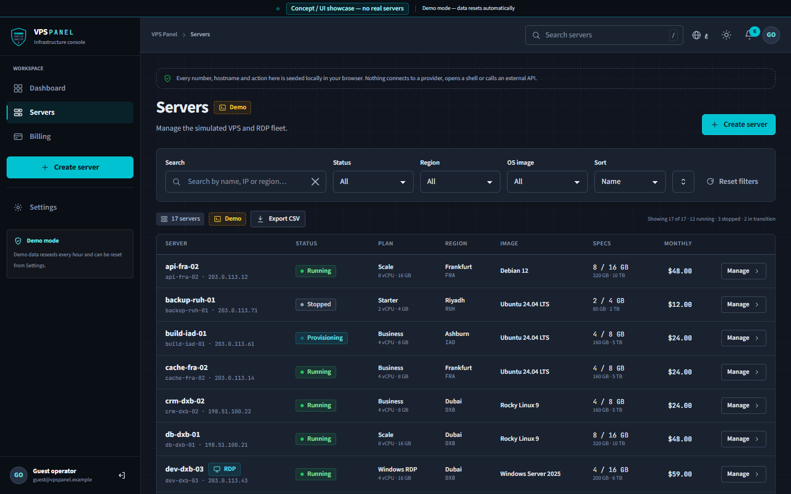
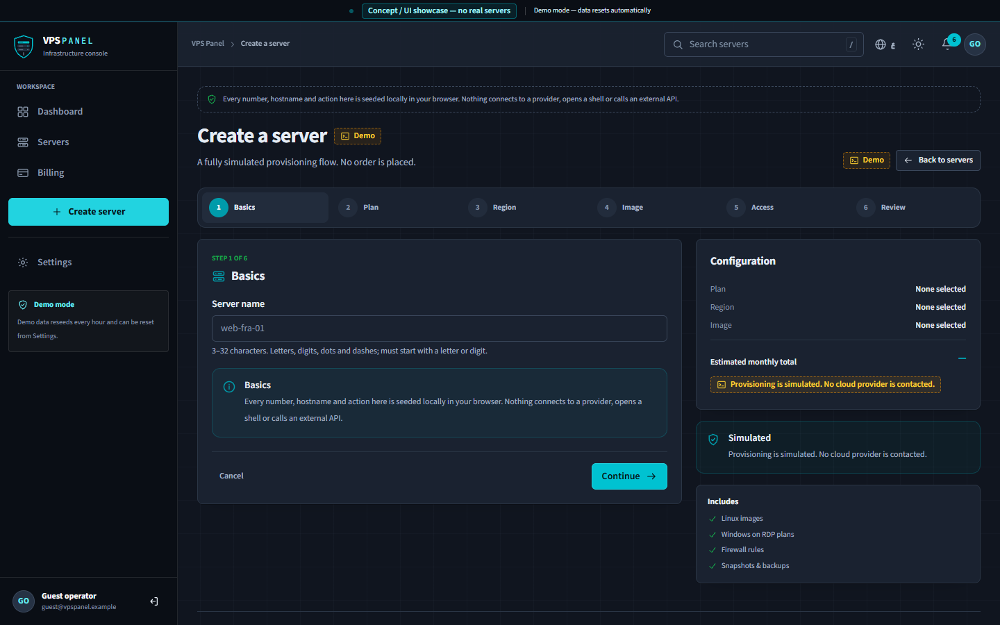
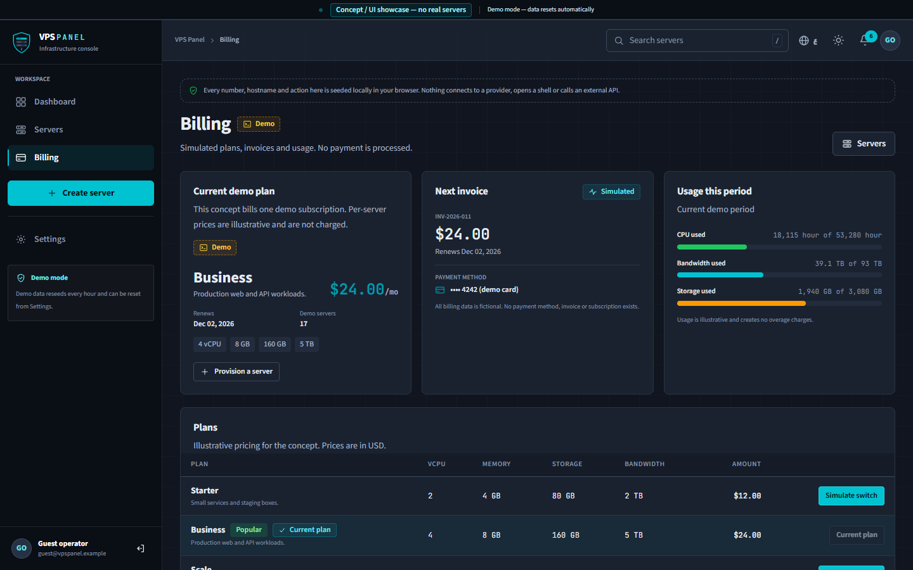
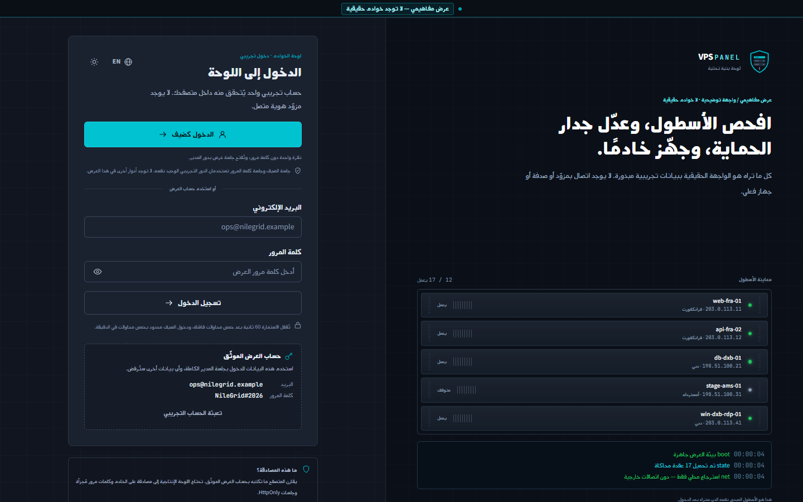
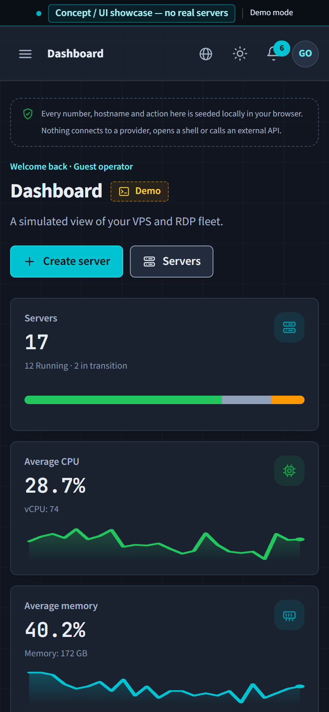
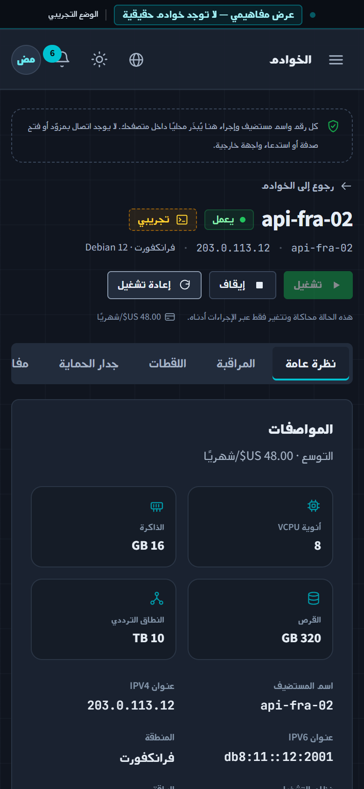

# VPS Panel

A control-panel interface for VPS and Windows RDP servers: fleet overview, server details, firewall, console and billing.



VPS Panel is a user-interface concept for a hosting provider's customer console. It shows how a fleet of servers can be monitored and managed from one place: rack-style overview, dense tables, a server page with firewall and snapshots, a provisioning flow and billing.

**This is a UI showcase.** All data is generated locally in the browser. It does not connect to any provider, server, shell or payment system.

The interface is Arabic-first (right-to-left) with a complete English version.

## Highlights

- **Fleet dashboard:** 17 demo servers across six regions, with status, resources and alerts.
- **Server page:** live-looking metrics, firewall rule editor, snapshots and a scripted console.
- **Create server:** a step-by-step provisioning flow with validation.
- **Billing:** invoices and usage, with CSV export.
- **Arabic and English**, dark and light themes, responsive down to phone width.

## Screenshots

**Server detail** · Arabic



**Servers** · English



**Create a server** · English



**Billing** · English



**Sign-in** · Arabic



**On mobile** (English and Arabic)

<p>
  
  
</p>

## Tech stack

| Layer | Technology |
| --- | --- |
| App | TypeScript, no UI framework |
| Build | Vite 8 |
| Styling | Tailwind CSS 4 |
| Fonts | Mada and JetBrains Mono, self-hosted |
| Tests | Vitest + jsdom |

No CDNs, trackers or analytics. All fonts and assets are self-hosted.

## Running locally

Requirements: Node.js 24 and npm.

```bash
npm install
npm run dev
```

Then open http://localhost:5175.

Full setup notes are in [INSTALL.md](INSTALL.md).

## Demo access

Click **Enter as guest** on the sign-in page. No password. The demo fleet reseeds every hour. Build with `VITE_DEMO_MODE=false` to remove guest entry.

All names, phone numbers, emails and records in the demo are fictional sample data.

## Tests

```bash
npm test
```

106 automated tests, all passing at the time of publishing. Details in [TESTING.md](TESTING.md).

## Documentation

- [INSTALL.md](INSTALL.md)
- [TESTING.md](TESTING.md)
- [SECURITY.md](SECURITY.md)
- [ROADMAP.md](ROADMAP.md)
- [docs/ARCHITECTURE.md](docs/ARCHITECTURE.md)
- [docs/DECISIONS.md](docs/DECISIONS.md)
- [THIRD-PARTY-NOTICES.md](THIRD-PARTY-NOTICES.md)

## License

Copyright © 2026 Fedaa Mohamed. All rights reserved.

This repository is public so the code can be reviewed. It is **not open source**: no permission is granted to use, copy, modify, distribute or sell any part of it without prior written permission. See [LICENSE](LICENSE). Third-party libraries and fonts keep their own licences, listed in [THIRD-PARTY-NOTICES.md](THIRD-PARTY-NOTICES.md).

---

Designed & built by [Fedaa Mohamed](https://fedaamohamed.com).
